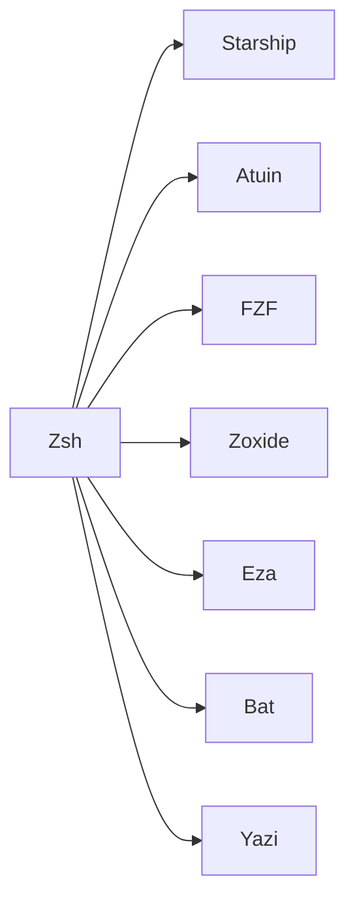

# Shell

## Chaîne interactive



| Élément | Rôle |
| --- | --- |
| Zsh | shell interactif et point d'intégration |
| Starship | prompt configuré par `starship/.config/starship.toml` |
| Atuin | recherche d'historique local ; base et clé exclues de Git |
| FZF | sélection interactive et prévisualisations |
| Zoxide | navigation par fréquence |
| Eza | affichage enrichi des répertoires |
| Bat | lecture et prévisualisation colorée |
| Yazi | gestionnaire de fichiers terminal |

`.zprofile` initialise la session graphique via UWSM lorsque son contexte le
permet. `.zshenv` publie le socket de l'agent SSH utilisateur. `.zshrc` charge
les intégrations interactives, aliases et fonctions.

## Plugins Zsh et Tmux

Les plugins ne sont pas téléchargés à chaque ouverture du shell. Git épingle
leurs commits comme sous-modules :

| Intégration | Chemin versionné |
| --- | --- |
| Fast Syntax Highlighting | `zsh/.zsh/plugins/fast-syntax-highlighting` |
| FZF Tab | `zsh/.zsh/plugins/fzf-tab` |
| Zsh Autosuggestions | `zsh/.zsh/plugins/zsh-autosuggestions` |
| Catppuccin Tmux | `tmux/.config/tmux/plugins/catppuccin/tmux` |

Initialisation et contrôle :

```bash
git submodule update --init --recursive
git submodule status --recursive
```

La configuration Zsh vérifie la lisibilité des fichiers de plugins avant de
les sourcer. Le dépôt parent, et non une commande lancée au démarrage du shell,
reste propriétaire des versions.

## Scripts utilisateur

Le package `bin` déploie des commandes dans `~/.local/bin`. Les familles
principales sont :

- maintenance Pacman/AUR (`aurinstall`, `aurremove`, `aursearch`, `aurupdate`) ;
- énergie et batterie (`batlimit`, `battery-low-notify.sh`) ;
- session et applications (`sway-close`, `thunderbird-proton`,
  `vmware-on-demand`, `nextcloud-sync`) ;
- développement local (`dcnvim`, `pi-dev`) ;
- acquisition/3D (`colmap-amd`, `scan3d`, `scan3d-watch`) ;
- intégrations Trainlog (`trainlog-bt-watch`) et autres projets locaux.

Ces scripts orchestrent des outils existants ; ils ne fournissent pas les
projets externes, credentials ou binaires système qu'ils appellent. Consulter
[`external-tools.md`](../.assets/external-tools.md) avant de les réutiliser sur
une autre machine.


Le 1er novembre 2026, les anciens helpers `cliphist-daemon.sh` (remplacé
par deux unités systemd), `sway-layout-ws1.sh`, `tlp-profile.sh`,
`kitty-ssh-add.sh` et `opencode-away` ont été retirés.
Les exécutables non versionnés `goose` et `agy` ont été mis en quarantaine
sous `~/.local/share/local-bin-archive/2026-11-01/`, hors du `PATH`.
Ils restent récupérables sans téléchargement ; supprimer cette archive
ultérieurement seulement après vérification de leur inutilité.
Les liens cassés `labfy-remote-ui`, `trainlog-btd`, `trainlog-syncd`
et `trainlog-sync-once` ont été retirés de `~/.local/bin` :
les services Trainlog utilisent maintenant directement les exécutables du
rollout vérifié dans leurs unités de base. La commande `trainlog` reste disponible.
Le lien `labfy-investigation-web` et son unité désactivée ont été
retirés au second audit : l'exécutable du service Web n'existe plus.
Le projet GTK de Labfy Investigation est indépendant de ce service Web.

## Entretien Zsh (novembre 2026)

Le chargement interactif déduplique le tableau `path` après l'initialisation
des outils (notamment pyenv). Les complétions Zsh utilisent désormais
`${XDG_CACHE_HOME:-$HOME/.cache}/zsh/zcompdump` et créent leur répertoire au
premier démarrage. Les associations Ctrl+R (Atuin) et Ctrl+F (FZF) restent
inchangées ; le shell et sa configuration sont gérés par les dotfiles.

Pour les opérations potentiellement destructives :

- `update` effectue `sudo pacman -Syu`, puis `aurupdate` uniquement si
  la première commande a réussi ; plus de renouvellement sudo permanent ;
- `orphans` transforme les noms de paquets Pacman en tableau Zsh afin de
  conserver un argument distinct par paquet ; Pacman demande confirmation ;
- `clean-exe --dry-run` affiche les seuls exécutables ELF réguliers du
  répertoire courant et ignore les fichiers suivis par Git ; sans cette
  option, il faut taper exactement `SUPPRIMER` avant la suppression ;
- `vrm --dry-run` affiche uniquement les répertoires `venv`/`.venv`
  contenant `pyvenv.cfg`, non symboliques ; une confirmation `SUPPRIMER`
  est obligatoire avant suppression. Aucun répertoire autre que ces deux
  noms n'est ciblé.

Pour l'OSINT, `dns` utilise `dig` au lieu de `dog`, `geoip <IP>` interroge
explicitement ipapi.co, `shot [full|region]` capture sous Wayland avec
`grim` et éventuellement `slurp` dans `~/Pictures/`. `subdomains <domaine>`
nécessite `subfinder` : son absence est signalée sans exécution de secours.
Ces commandes réseau ne sont pas lancées lors de l'ouverture du shell.

## Données locales

L'historique Zsh et le store Atuin sont des données utilisateur, pas de la
configuration. La clé, la base, les sessions et tout identifiant Atuin restent
hors Git. Cette installation utilise Atuin localement ; aucune procédure de
compte ou de synchronisation distante n'est requise par le dépôt.
